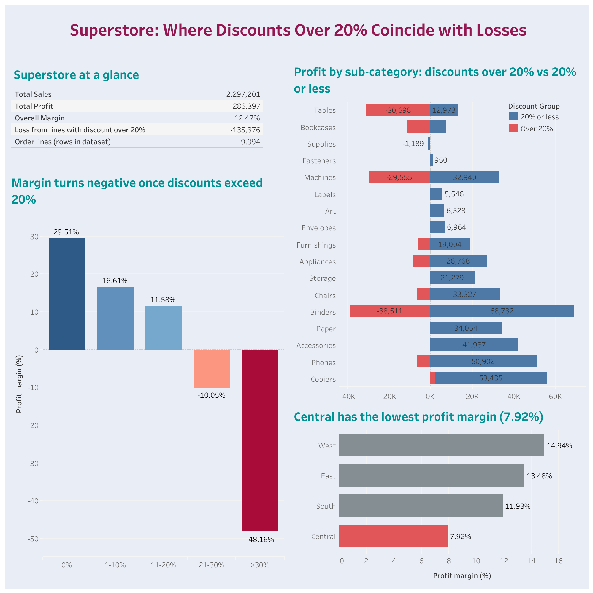

# Superstore: Profit and Discount Analysis

SQL analysis and Tableau dashboard exploring how order lines with high discounts relate to profit in the Superstore dataset.

**Live dashboard:** [View on Tableau Public](https://public.tableau.com/views/SuperstoreDashboard_17949088027190/Dashboard1)

## Business Question
How do discount levels relate to profit, and where are losses concentrated across sub-categories and regions?

## Data
- Source: [Superstore Dataset on Kaggle](https://www.kaggle.com/datasets/vivek468/superstore-dataset-final) (uploaded by vivek468; the uploader states it originated from Tableau sample data)
- 9,994 order lines
- Public sample data for educational purposes only. It is not verified real business data.
- The raw dataset is not included in this repository. Please download it from Kaggle.

## Method
- Checked data quality, created a clean table, and queried it with SQL (see [`/sql`](sql)). The numbered files run in order.
- Raw and cleaned tables both have 9,994 rows.
- Rows 3406 and 3407 are identical except for `Row ID`. Both were kept because it cannot be confirmed that they are true duplicates.
- Exported three summary tables (see [`/results`](results)) for Tableau. They have different levels of detail and are not joined.

## Key Findings

| Discount band | Profit margin |
|---|---|
| 0% | 29.51% |
| 1-10% | 16.61% |
| 11-20% | 11.58% |
| 21-30% | -10.05% |
| >30% | -48.16% |

- Overall: Sales 2,297,201, Profit 286,397, Margin 12.47%.
- Lines discounted over 20%: 1,393 lines with a combined loss of 135,376.
- Binders, Tables and Machines have the largest losses among lines discounted over 20% (combined loss 98,764).
- Central has the lowest margin (7.92%) and the highest share of lines discounted over 20% (27.7%). West has the highest margin (14.94%).
- Supplies shows a loss even without lines discounted over 20%.

## Repository Structure

| Folder | Contents |
|---|---|
| `sql/` | Numbered SQL scripts: data quality, clean table, category/region/discount analysis, and the Tableau export query |
| `results/` | Three summary CSV files used in the dashboard |
| `images/` | Dashboard screenshot |

## Limitations
- These results show association, not causation.
- The dataset has no cost data, so the causes of losses cannot be explained.
- There is no data between 20% and 30% discount, so the exact tipping point cannot be identified.
- The 135,376 loss is not profit that could be recovered by removing discounts, because sales volume would likely change.

## Tools
SQL, Tableau Public

## Attribution
Data: "Superstore Dataset" on Kaggle (uploaded by vivek468), originally from Tableau sample data. Used for educational and portfolio purposes only.
